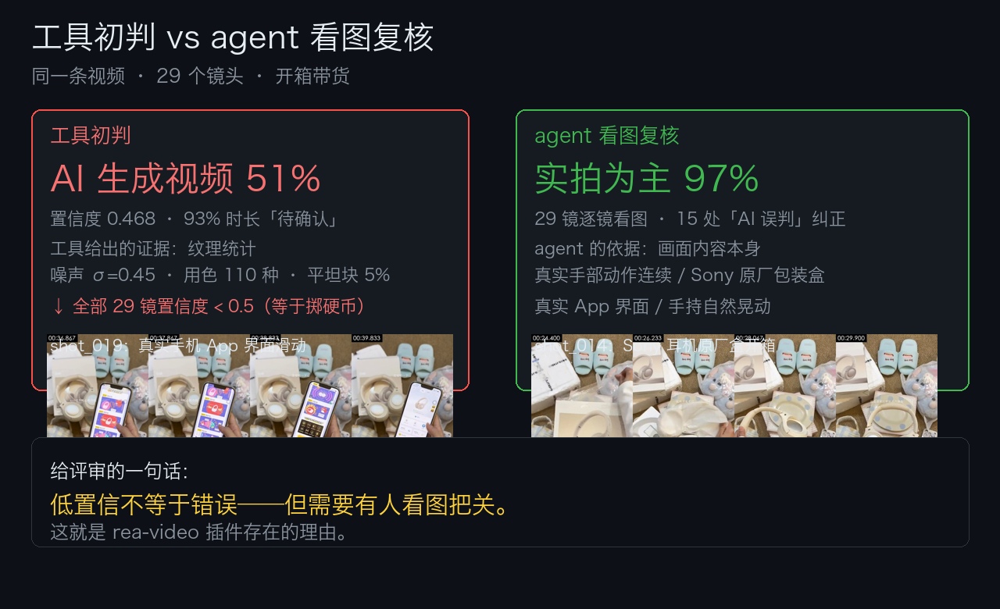

# hermes-plugin-rea-video

**给 Hermes Agent 装上视频逆向能力**：丢一条视频（或抖音链接），Hermes 逐镜告诉你
实拍 / AI 生成 / 3D / 录屏各占多少、字幕花字的时间轴、声音是不是 AI、以及怎么复刻一条一样的。

<video src="https://github.com/wusanjay/hermes-plugin-rea-video/releases/download/v0.1.0/demo_hackathon_final.mp4" controls width="100%"></video>

*Demo：让 Hermes 当面拆解一条视频 → 逐镜判定 → 对低置信镜头亲自看图复核。*



**端到端实测（2026-11-11）**：63 秒真实视频走完整循环——16 镜分解（AI 42% / 模板渲染 39% / 静图 13%），agent 复核最争议镜头（ai_video 0.45 vs static_hold 0.29）后判 code_render 并回写融合。证据：[demo/e2e_run/](demo/e2e_run/)（report.md · breakdown.json · storyboard · agent transcript）。

> Powered by [JuneYaooo/rea-video](https://github.com/JuneYaooo/rea-video) (Apache-2.0) —
> 本仓库只是 Hermes 插件封装（MCP server + skill），全部核心能力来自上游工具，依赖钉死在
> commit `d904b1e8328515dc95d9772cd2e65fb8acde996d`（Apache-2.0 第 9 条不可撤回，上游任何后续变化不影响本插件）。
> 上游贡献：shot 复核的 `split_suggestion` 与 disputed-review 融合规则由本仓库维护者的 PR 已合入上游。

## 架构

```
用户: "拆一下这条视频" + 链接
  └─ resolve_douyin   分享链接 → 视频页（下载由用户/工具完成）
  └─ decompose_video  15 镜分类 + 142 句字幕时间轴 + 人声/配乐分离
  └─ video_summary    结论 + 低置信镜头清单
  └─ shot_tiles × N   Hermes 用自己的视觉能力看图复核（agent-as-VLM）
  └─ submit_review    复核并入，报告定稿
→ report.html / report.md / subtitles.srt / 复刻方案
```

## 安装

```bash
pip install -e .
# 运行需要 ffmpeg + Python 3.10+
```

Hermes 注册：把 mcp_server.py 以 stdio MCP server 挂进 Hermes 配置，skills/ 放入技能目录。

## 提交到官方插件目录

参见 `catalog/hermes-plugin-rea-video.yaml`（对 hermes-agent 仓库 plugin-catalog 的 PR 即收录）。

## Demo

见 `demo/DEMO.md`（脚本与分镜）。
