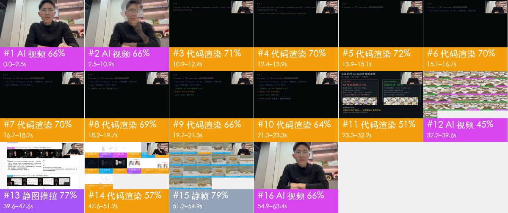

# 视频拆解报告：demo_v6_final.mp4

**结论**：混合制作：AI 生成视频 42% + 代码/模板渲染 39% + 静态图 + 推拉动效 13% + 静帧停留 6%（其中 31% 时长实拍还是 AI 证据不足，待确认）；叠加层：图形贴片、静态贴纸（代码/剪辑软件合成）；声音：人声 + 音效 9 处；剪辑包装：贴纸/动图 4 处

- 时长 63.367s · 1280×720 · 30.0fps · 16:9
- 镜头 16 个，平均 3.96s；转场：cut×14、dissolve×1、start×1
- 判断置信度（按时长加权）：64%；判定方式：确定性取证 + agent 看图融合
- 由 hermes 看图复核 1/16 个镜头，已并入结论



## 制作方式占比

| 底层画面 | 时长 | 占比 |
|---|---|---|
| AI 生成视频 | 26.73s | 42% |
| 代码/模板渲染 | 24.9s | 39% |
| 静态图 + 推拉动效 | 8.0s | 13% |
| 静帧停留 | 3.73s | 6% |

## 复刻方案

**AI 视频 4 镜 → 4 个生成单元、4 次 Seedance 2.5 调用；代码渲染/录屏 10 镜 → 1 个代码工程（2 段）；静图推拉/静帧 2 镜 → 本地重建**

- 默认引擎 Seedance 2.0（含 Mini / Fast） 不支持一次多镜头，用它要逐镜生成 4 次；这里按 Seedance 2.5 规划（单次 ≤30s、可一次出多镜头），共 4 次
- 分组规则：同场景、硬切相连的 AI 镜头合并为一次生成（S01）；单次 ≤30s；单元内连续硬切尽量 ≤8s、最多 10s（S06）；在叠化/淡入淡出和换场景处切开（S03）
- 声音：模型可以同时生成动作音效和环境声；口播建议单独 TTS 再混进去，方便改文案和卡时间

### 生成单元

| 单元 | 镜头 | 时间 | 时长 | 方式 | 衔接 |
|---|---|---|---|---|---|
| G1 | #1 | 0.0–2.5s | 2.5s | 单镜 | 首帧：参照原片第 1 镜首帧（shots/shot_001_first.jpg）的构图出图 |
| G2 | #2 | 2.5–10.9s | 8.3s | 单镜 | 首帧：参照原片第 2 镜首帧（shots/shot_002_first.jpg）的构图出图 |
| G3 | #12 | 32.2–39.6s | 7.4s | 单镜 | 首帧：参照原片第 12 镜首帧（shots/shot_012_first.jpg）的构图出图 |
| G4 | #16 | 54.9–63.4s | 8.5s | 单镜 | 首帧：参照原片第 16 镜首帧（shots/shot_016_first.jpg）的构图出图 |

**G1 · AI 生成视频 · 镜头 #1 · 2.5s**

- 参考素材：`@图片1` 人物参考图（每个角色一张正脸 + 半身），保证跨镜头长相一致；`@视频1` 原片 0.0–2.5s 片段：参考动作、运镜和剪辑节奏（只作参考，不复制画面）
- 生成 4s 后剪到 2.5s（太短的镜头单独生成不稳定）
- 镜头 #1 缺提示词

```text
横屏 16:9；逆光/背景比主体亮，柔光（几乎没有明暗分界），中性（约 5000K），背景清晰。人物以 @图片1 为准。参考 @视频1 的动作、运镜和剪辑节奏。
（缺提示词：开 --vlm 或 agent 看图补写）
```

**G2 · AI 生成视频 · 镜头 #2 · 8.3s**

- 参考素材：`@图片1` 人物参考图（每个角色一张正脸 + 半身），保证跨镜头长相一致；`@视频1` 原片 2.5–10.9s 片段：参考动作、运镜和剪辑节奏（只作参考，不复制画面）
- 镜头 #2 缺提示词

```text
横屏 16:9；逆光/背景比主体亮，柔光（几乎没有明暗分界），中性（约 5000K），背景清晰。人物以 @图片1 为准。参考 @视频1 的动作、运镜和剪辑节奏。
（缺提示词：开 --vlm 或 agent 看图补写）
```

**G3 · AI 生成视频 · 镜头 #12 · 7.4s**

- 参考素材：`@图片1` 人物参考图（每个角色一张正脸 + 半身），保证跨镜头长相一致；`@视频1` 原片 32.2–39.6s 片段：参考动作、运镜和剪辑节奏（只作参考，不复制画面）
- 镜头 #12 缺提示词

```text
横屏 16:9；逆光/背景比主体亮，柔光（几乎没有明暗分界），中性（约 5000K），背景清晰。人物以 @图片1 为准。参考 @视频1 的动作、运镜和剪辑节奏。
（缺提示词：开 --vlm 或 agent 看图补写）
```

**G4 · AI 生成视频 · 镜头 #16 · 8.5s**

- 参考素材：`@图片1` 人物参考图（每个角色一张正脸 + 半身），保证跨镜头长相一致；`@视频1` 原片 54.9–63.4s 片段：参考动作、运镜和剪辑节奏（只作参考，不复制画面）
- 镜头 #16 缺提示词

```text
横屏 16:9；逆光/背景比主体亮，柔光（几乎没有明暗分界），中性（约 5000K），背景清晰。人物以 @图片1 为准。参考 @视频1 的动作、运镜和剪辑节奏。
（缺提示词：开 --vlm 或 agent 看图补写）
```

### 代码合成

一个 Remotion/HTML 工程，按文字轨和版式重建（文字、界面 100% 可控，改文案只改数据）；可以让 LLM 直接写这个工程。

- 段1：镜头 #3、#4、#5、#6、#7、#8、#9、#10、#11（10.9–32.2s）
- 段2：镜头 #14（47.6–51.2s）

### 本地重建

- #13 静态图 + 推拉动效 8.0s；#15 静帧停留 3.7s：一张图 + 测得的缩放/平移参数，ffmpeg 直接出

## 拍法、打光与剪辑

- 取景：景别 大特写 72%、中景 28%；主体是人脸（按脸高算景别）
- 机位：固定机位（三脚架/支架/放在桌上） 100%
- 打光：逆光/背景比主体亮。主光 正面（光从镜头方向来，主体两侧亮度接近），与主体同高；光比 约 1.1:1（相差 0.2 档）；柔光（几乎没有明暗分界）；色温中性（约 5000K）；背景清晰
- （画面不是实拍：以上是画面里的光影，用于写生成提示词，不是拍摄方案）
- 调色：自然（接近原色）；低饱和、高对比、黑位正常、整体中性
- 剪辑：每分钟 14.2 刀，平均镜头 3.96s；没有实拍镜头

| 维度 | 项目 | 结论 | 来源 |
|---|---|---|---|
| 取景 | 景别 | 大特写 | 测量：大特写 |
| 机位 | 拍摄方式 | 固定机位（三脚架/支架/放在桌上） | 测量：固定机位（三脚架/支架/放在桌上） |
| 打光 | 软硬 | 柔光（几乎没有明暗分界） | 测量：柔光（几乎没有明暗分界） |
| 打光 | 色温 | 中性（约 5000K） | 测量：中性（约 5000K） |
| 调色 | 调色风格 | 自然（接近原色） | 测量：自然（接近原色） |

- 说明：光比、软硬、色温、景别由主体像素测得（有人脸用人脸，没有用画面清晰区域，后者是估算）；平台转码会压暗部，软硬和补光偏保守；机位角度、光源种类、眼神光、轮廓光以看图结果为准。测量和看图不一致时两者都列出。

## 元数据线索

- 编码器：`Lavf63.1.102`

## 声音拆解


- 整体响度 -25.5 dBFS，峰值 -5.6 dBFS
- **人声**：有，占 68% 时长，基频约 117.3Hz（偏男声）
- **背景音乐**：未检测到持续的音乐床

**声音来源：AI 生成还是现成素材**

- **结论**：视频类型：旁白/口播 + 配乐 → 人声TTS 配音；音效音效库/剪辑软件后期添加（倾向，待确认）
- **剥离出的音轨**：`stems/original.wav`（原声）、`stems/vocals.wav`（人声干声，瞬态音效也会落在这里）、`stems/music.wav`（配乐 + 环境声）
- 视频形式：普通视频配乐；AI 画面占 42%，实拍占 0%
- **人声**：TTS 配音（tts 64%，human_recording 27%，ai_video_native 9%）
  - 人声和背景声跨切点连续：整条旁白是后期单独配上去的（TTS 或真人配音）
- **音效**：音效库/剪辑软件后期添加（library_editor 57%，ai_native 29%，live_sync 14%）
- 逐段原生音频检测：切点处背景声变化 15.8dB，镜头内 16.5dB（比值 0.96）→ 声音跨切点连续，是后期整体铺的

**音效**（9 处；来源 vlm=大模型听出，deterministic=信号检测的候选，置信度低）

| 时间 | 类型 | 描述 | 对应画面 | 来源 |
|---|---|---|---|---|
| 7.65s | pop |  |  | deterministic |
| 27.50s | pop |  |  | deterministic |
| 28.70s | pop |  |  | deterministic |
| 28.80s | pop |  |  | deterministic |
| 45.79s | pop |  |  | deterministic |
| 49.16s | pop |  |  | deterministic |
| 56.85s | pop |  |  | deterministic |
| 60.71s | pop |  |  | deterministic |
| 61.10s | pop |  |  | deterministic |

**声音复刻方案**

- voice（A01-narration）：人声，male → capsule-cinema DoubaoTTSTool / UniversalTTSTool（或 MiniMax 克隆音色）；需要卡原时间窗时用时长可控 TTS（A02）
- sfx（A04-sfx）：9 个音效 → 按时间点摆放：capsule-cinema SoundEffectsTool / 音效库，或像 plush 配方那样程序合成（音高对齐 BGM 调性）

## 剪辑包装层（字幕 / 花字 / 贴纸 / 音效卡点）

- 贴纸/动图 静态贴纸/图片 4 处
- 导出：`packaging/timeline.json`（SRT 是字幕时间轴；ASS 带颜色、描边、位置和入场动画，字体需要换成原片字体；timeline.json 是完整时间轴）

**贴纸 / 动图 / 画中画**

| 时间 | 类型 | 位置 | 动态 | 置信 | 截图 |
|---|---|---|---|---|---|
| 23.40–39.50s | 静态贴纸/图片 | x55% y55% 宽40% 高18% | 静止 | 中（跨切镜不变） |  |
| 23.40–39.50s | 静态贴纸/图片 | x5% y55% 宽35% 高18% | 静止 | 中（跨切镜不变） |  |
| 23.40–39.50s | 静态贴纸/图片 | x75% y9% 宽20% 高18% | 静止 | 中（跨切镜不变） |  |
| 44.10–47.50s | 静态贴纸/图片 | x75% y9% 宽10% 高18% | 静止 | 中 |  |

复刻：字幕和花字用 `packaging/overlays.ass` 直接压制（ffmpeg -vf ass=overlays.ass），或按 timeline.json 在剪映 / Remotion 里重建；贴纸和动图要找同款素材（表情包库 / GIF 库），截图在 packaging/ 下。

## 分镜表

| # | 时间 | 时长 | 底层画面 | 置信度 | 素材来源 | 叠加层 | 运镜 | 复刻路线 |
|---|---|---|---|---|---|---|---|---|
| 1 | 00:00.000 | 2.53s | AI 生成视频 | 66% | AI 生成 | 图形贴片 | 固定 | R07-product-hero → capsule_cinema |
| 2 | 00:02.533 | 8.33s | AI 生成视频 | 66% | AI 生成 | 图形贴片 | 固定 | R07-product-hero → capsule_cinema |
| 3 | 00:10.867 | 1.53s | 代码/模板渲染 | 71% | 制作方渲染；待确认是否真实：照片/图片素材 | — | 固定 | R01-code-graphics → code_render_spec |
| 4 | 00:12.400 | 1.53s | 代码/模板渲染 | 70% | 制作方渲染；待确认是否真实：照片/图片素材 | — | 固定 | R01-code-graphics → code_render_spec |
| 5 | 00:13.933 | 1.20s | 代码/模板渲染 | 72% | 制作方渲染 | — | 固定 | R01-code-graphics → code_render_spec |
| 6 | 00:15.133 | 1.53s | 代码/模板渲染 | 70% | 制作方渲染 | — | 固定 | R01-code-graphics → code_render_spec |
| 7 | 00:16.667 | 1.53s | 代码/模板渲染 | 70% | 制作方渲染 | — | 固定 | R01-code-graphics → code_render_spec |
| 8 | 00:18.200 | 1.53s | 代码/模板渲染 | 69% | 制作方渲染 | — | 固定 | R01-code-graphics → code_render_spec |
| 9 | 00:19.733 | 1.53s | 代码/模板渲染 | 66% | 制作方渲染 | — | 固定 | R01-code-graphics → code_render_spec |
| 10 | 00:21.267 | 2.00s | 代码/模板渲染 | 64% | 制作方渲染 | — | 固定 | R01-code-graphics → code_render_spec |
| 11 | 00:23.267 | 8.97s | 代码/模板渲染 | 51% | 制作方渲染；待确认是否真实：嵌入视频片段、照片/图片素材 | 静态贴纸 | 固定 | R01-code-graphics → code_render_spec |
| 12 | 00:32.233 | 7.40s | AI 生成视频 | 45% | AI 生成 | 静态贴纸 | 固定 | R07-product-hero → capsule_cinema |
| 13 | 00:39.633 | 8.00s | 静态图 + 推拉动效 | 77% | 制作方渲染；待确认是否真实：照片/图片素材 | 图形贴片、静态贴纸 | 整图推拉/平移 | R17-still-motion → local_ffmpeg |
| 14 | 00:47.633 | 3.53s | 代码/模板渲染 | 57% | 制作方渲染；待确认是否真实：嵌入视频片段 | — | 固定 | R01-code-graphics → code_render_spec |
| 15 | 00:51.167 | 3.73s | 静帧停留 | 79% | 待确认；待确认是否真实：照片/图片素材 | — | 固定 | R18-static-hold → local_ffmpeg |
| 16 | 00:54.900 | 8.47s | AI 生成视频 | 66% | AI 生成 | — | 固定 | R07-product-hero → capsule_cinema |

## 逐镜详情

### #1 00:00.000–00:02.533 · AI 生成视频 + 代码/剪辑叠加（图形贴片）


- 概率：AI 生成视频 66%，数字人口播 19%，3D 渲染 8%（deterministic）
- ⚠️ 待确认：AI 还是 24p 相机实拍待确认：只有帧率证据（24fps 源）、没有 AIGC 标识，需要看图确认
- 素材来源：AI 生成
- 镜头内动效节拍：0.67s
- 纹理呈照片/视频特征：噪声 σ=0.25、用色 111 种、平坦块 12%
- 重复帧呈 24→30 规律（17%，周期 6）：原始素材为 24/25fps 后转码，常见于 AI 生成视频、3D/动画渲染或电影素材
- 100% 的采样帧有正脸且机位固定，音轨有人声
- 拍法/打光：大特写；固定机位（三脚架/支架/放在桌上）；逆光/背景比主体亮；主光正面（光从镜头方向来，主体两侧亮度接近）；光比约 1.1:1（相差 0.1 档）；柔光（几乎没有明暗分界）
- 复刻：原片为 AI 生成：取原镜头首尾帧做首尾帧生成，可高度还原构图与动作；换主体时先用图像模型改首帧

### #2 00:02.533–00:10.867 · AI 生成视频 + 代码/剪辑叠加（图形贴片）


- 概率：AI 生成视频 66%，数字人口播 19%，3D 渲染 9%（deterministic）
- ⚠️ 待确认：AI 还是 24p 相机实拍待确认：只有帧率证据（24fps 源）、没有 AIGC 标识，需要看图确认
- 素材来源：AI 生成
- 纹理呈照片/视频特征：噪声 σ=0.26、用色 106 种、平坦块 13%
- 重复帧呈 24→30 规律（17%，周期 6）：原始素材为 24/25fps 后转码，常见于 AI 生成视频、3D/动画渲染或电影素材
- 100% 的采样帧有正脸且机位固定，音轨有人声
- 拍法/打光：大特写；固定机位（三脚架/支架/放在桌上）；逆光/背景比主体亮；主光正面（光从镜头方向来，主体两侧亮度接近）；光比约 1.1:1（相差 0.2 档）；柔光（几乎没有明暗分界）
- 复刻：原片为 AI 生成：取原镜头首尾帧做首尾帧生成，可高度还原构图与动作；换主体时先用图像模型改首帧

### #3 00:10.867–00:12.400 · 代码/模板渲染


- 概率：代码/模板渲染 71%，3D 渲染 8%，屏幕录制/截图 7%（deterministic）
- 素材来源：制作方渲染；待确认是否真实：照片/图片素材
- 95% 的相邻帧完全重复，只有局部元素在动（典型的模板/MG 动画或定格后局部动效）
- 纹理呈渲染特征：平坦色块 86%、95% 像素仅用 12 种颜色、横竖直边 26%
- 背景 99% 像素逐帧完全不变、只有局部元素在动：2D 合成/代码动效特征
- 复刻：代码渲染：用 Remotion/HTML 按文字轨与版式重建，100% 可控，不需要生成模型

### #4 00:12.400–00:13.933 · 代码/模板渲染


- 概率：代码/模板渲染 70%，屏幕录制/截图 11%，AI 生成视频 7%（deterministic）
- 素材来源：制作方渲染；待确认是否真实：照片/图片素材
- 93% 的相邻帧完全重复，只有局部元素在动（典型的模板/MG 动画或定格后局部动效）
- 纹理呈渲染特征：平坦色块 82%、95% 像素仅用 19 种颜色、横竖直边 24%
- 平坦底色上有大量细小高频细节（小字号文字/界面），像截图或文档画面
- 背景 100% 像素逐帧完全不变、只有局部元素在动：2D 合成/代码动效特征
- 复刻：代码渲染：用 Remotion/HTML 按文字轨与版式重建，100% 可控，不需要生成模型

### #5 00:13.933–00:15.133 · 代码/模板渲染


- 概率：代码/模板渲染 72%，3D 渲染 10%，AI 生成视频 6%（deterministic）
- 素材来源：制作方渲染
- 90% 的相邻帧完全重复，只有局部元素在动（典型的模板/MG 动画或定格后局部动效）
- 纹理呈渲染特征：平坦色块 89%、95% 像素仅用 9 种颜色、横竖直边 28%
- 背景 99% 像素逐帧完全不变、只有局部元素在动：2D 合成/代码动效特征
- 复刻：代码渲染：用 Remotion/HTML 按文字轨与版式重建，100% 可控，不需要生成模型

### #6 00:15.133–00:16.667 · 代码/模板渲染


- 概率：代码/模板渲染 70%，屏幕录制/截图 8%，AI 生成视频 7%（deterministic）
- 素材来源：制作方渲染
- 93% 的相邻帧完全重复，只有局部元素在动（典型的模板/MG 动画或定格后局部动效）
- 纹理呈渲染特征：平坦色块 85%、95% 像素仅用 18 种颜色、横竖直边 24%
- 背景 99% 像素逐帧完全不变、只有局部元素在动：2D 合成/代码动效特征
- 复刻：代码渲染：用 Remotion/HTML 按文字轨与版式重建，100% 可控，不需要生成模型

### #7 00:16.667–00:18.200 · 代码/模板渲染


- 概率：代码/模板渲染 70%，屏幕录制/截图 11%，AI 生成视频 7%（deterministic）
- 素材来源：制作方渲染
- 95% 的相邻帧完全重复，只有局部元素在动（典型的模板/MG 动画或定格后局部动效）
- 纹理呈渲染特征：平坦色块 83%、95% 像素仅用 25 种颜色、横竖直边 23%
- 平坦底色上有大量细小高频细节（小字号文字/界面），像截图或文档画面
- 背景 99% 像素逐帧完全不变、只有局部元素在动：2D 合成/代码动效特征
- 复刻：代码渲染：用 Remotion/HTML 按文字轨与版式重建，100% 可控，不需要生成模型

### #8 00:18.200–00:19.733 · 代码/模板渲染


- 概率：代码/模板渲染 69%，屏幕录制/截图 12%，AI 生成视频 7%（deterministic）
- 素材来源：制作方渲染
- 93% 的相邻帧完全重复，只有局部元素在动（典型的模板/MG 动画或定格后局部动效）
- 纹理呈渲染特征：平坦色块 81%、95% 像素仅用 34 种颜色、横竖直边 22%
- 平坦底色上有大量细小高频细节（小字号文字/界面），像截图或文档画面
- 背景 100% 像素逐帧完全不变、只有局部元素在动：2D 合成/代码动效特征
- 复刻：代码渲染：用 Remotion/HTML 按文字轨与版式重建，100% 可控，不需要生成模型

### #9 00:19.733–00:21.267 · 代码/模板渲染


- 概率：代码/模板渲染 66%，屏幕录制/截图 13%，AI 生成视频 9%（deterministic）
- 素材来源：制作方渲染
- 93% 的相邻帧完全重复，只有局部元素在动（典型的模板/MG 动画或定格后局部动效）
- 纹理呈渲染特征：平坦色块 78%、95% 像素仅用 52 种颜色、横竖直边 20%
- 平坦底色上有大量细小高频细节（小字号文字/界面），像截图或文档画面
- 背景 99% 像素逐帧完全不变、只有局部元素在动：2D 合成/代码动效特征
- 复刻：代码渲染：用 Remotion/HTML 按文字轨与版式重建，100% 可控，不需要生成模型

### #10 00:21.267–00:23.267 · 代码/模板渲染


- 概率：代码/模板渲染 64%，屏幕录制/截图 13%，AI 生成视频 10%（deterministic）
- 素材来源：制作方渲染
- 96% 的相邻帧完全重复，只有局部元素在动（典型的模板/MG 动画或定格后局部动效）
- 纹理呈渲染特征：平坦色块 75%、95% 像素仅用 57 种颜色、横竖直边 20%
- 平坦底色上有大量细小高频细节（小字号文字/界面），像截图或文档画面
- 背景 100% 像素逐帧完全不变、只有局部元素在动：2D 合成/代码动效特征
- 复刻：代码渲染：用 Remotion/HTML 按文字轨与版式重建，100% 可控，不需要生成模型

### #11 00:23.267–00:32.233 · 代码/模板渲染 + 代码/剪辑叠加（静态贴纸）


- 概率：代码/模板渲染 51%，AI 生成视频 21%，静帧停留 13%（deterministic）
- 素材来源：制作方渲染；待确认是否真实：嵌入视频片段、照片/图片素材
- 97% 的相邻帧完全重复，只有局部元素在动（典型的模板/MG 动画或定格后局部动效）
- 背景 99% 像素逐帧完全不变、只有局部元素在动：2D 合成/代码动效特征
- 复刻：代码渲染：用 Remotion/HTML 按文字轨与版式重建，100% 可控，不需要生成模型

### #12 00:32.233–00:39.633 · AI 生成视频 + 代码/剪辑叠加（静态贴纸）


- 概率：AI 生成视频 45%，静帧停留 29%，代码/模板渲染 10%（fused_agent）
- 素材来源：AI 生成
- 100% 的相邻帧完全重复，只有局部元素在动（典型的模板/MG 动画或定格后局部动效）
- 纹理呈照片/视频特征：噪声 σ=2.40、用色 173 种、平坦块 10%
- 背景 99% 像素逐帧完全不变、只有局部元素在动：2D 合成/代码动效特征
- [hermes 看图] 整
- [hermes 看图] 屏
- [hermes 看图] 是
- [hermes 看图] 产
- [hermes 看图] 品
- 拍法/打光：中景；固定机位（三脚架/支架/放在桌上）；正面柔光（平光）；主光正面（光从镜头方向来，主体两侧亮度接近）；光比约 1.0:1（相差 0.0 档）；柔光（几乎没有明暗分界）
- 复刻：原片为 AI 生成：取原镜头首尾帧做首尾帧生成，可高度还原构图与动作；换主体时先用图像模型改首帧

### #13 00:39.633–00:47.633 · 静态图 + 推拉动效（设计/渲染图形） + 代码/剪辑叠加（图形贴片、静态贴纸）


- 概率：静态图 + 推拉动效 77%，屏幕录制/截图 11%，AI 生成视频 9%（deterministic）
- 静帧来源：graphic
- 素材来源：制作方渲染；待确认是否真实：照片/图片素材
- 整帧按单一刚体变换运动（拟合内点 100%，残差 0.02px，无局部运动）→ 静态图推拉：缩放 +0.0%/s，平移 390px/s
- 纹理呈渲染特征：平坦色块 39%、95% 像素仅用 30 种颜色、横竖直边 26%
- 画面统计只在贴纸/动图之外的区域测量（x0% y0% 宽75% 高100%）
- 复刻：静态图推拉：用一张图 + 测得的缩放/平移参数在本地 ffmpeg 精确复刻

### #14 00:47.633–00:51.167 · 代码/模板渲染


- 概率：代码/模板渲染 57%，静帧停留 33%，屏幕录制/截图 6%（deterministic）
- 素材来源：制作方渲染；待确认是否真实：嵌入视频片段
- 画面几乎完全静止：89% 的相邻帧逐像素重复，首尾帧差 0.95
- 纹理呈渲染特征：平坦色块 43%、95% 像素仅用 141 种颜色、横竖直边 42%
- 复刻：代码渲染：用 Remotion/HTML 按文字轨与版式重建，100% 可控，不需要生成模型

### #15 00:51.167–00:54.900 · 静帧停留


- 概率：静帧停留 79%，代码/模板渲染 15%，屏幕录制/截图 2%（deterministic）
- 静帧来源：unknown
- 素材来源：待确认；待确认是否真实：照片/图片素材
- 画面几乎完全静止：100% 的相邻帧逐像素重复，首尾帧差 0.22
- 纹理呈照片/视频特征：噪声 σ=0.63、用色 140 种、平坦块 12%
- 复刻：静帧：一张图定格即可

### #16 00:54.900–01:03.367 · AI 生成视频


- 概率：AI 生成视频 66%，数字人口播 19%，3D 渲染 8%（deterministic）
- ⚠️ 待确认：AI 还是 24p 相机实拍待确认：只有帧率证据（24fps 源）、没有 AIGC 标识，需要看图确认
- 素材来源：AI 生成
- 纹理呈照片/视频特征：噪声 σ=0.26、用色 112 种、平坦块 13%
- 重复帧呈 24→30 规律（17%，周期 6）：原始素材为 24/25fps 后转码，常见于 AI 生成视频、3D/动画渲染或电影素材
- 100% 的采样帧有正脸且机位固定，音轨有人声
- 拍法/打光：大特写；固定机位（三脚架/支架/放在桌上）；逆光/背景比主体亮；主光正面（光从镜头方向来，主体两侧亮度接近）；光比约 1.1:1（相差 0.2 档）；柔光（几乎没有明暗分界）
- 复刻：原片为 AI 生成：取原镜头首尾帧做首尾帧生成，可高度还原构图与动作；换主体时先用图像模型改首帧

## 说明

- 确定性取证对「是否在动、是否整图推拉、是否渲染纹理、是否 24→30 帧率转换」很可靠；对实拍 / AI / 3D 的区分要依赖 VLM 与人工复核。
- 元数据经平台转码常被清除，缺失不代表没有。
