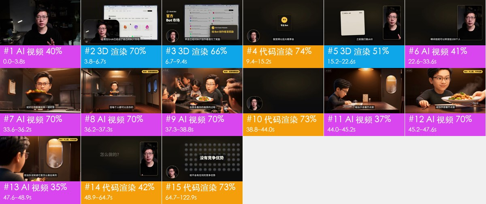

# 视频拆解报告：大瑞Keaton-Grokbot-BOT生意.mp4

**结论**：混合制作：代码/模板渲染 69% + AI 生成视频 20% + 3D 渲染 11%；叠加层：图形贴片（代码/剪辑软件合成）；声音：人声 + 音效 21 处

- 时长 122.9s · 3840×2160 · 30.0fps · 16:9
- 镜头 15 个，平均 8.19s；转场：cut×11、dissolve×3、start×1
- 判断置信度（按时长加权）：63%；判定方式：仅确定性取证
- 未开 VLM；实拍/AI/3D 的区分只靠像素统计，可信度有限。能看图的 agent：运行 rea-video review 逐镜看图并 apply-review 并入；否则建议配置 VLM（任意 OpenAI 兼容的多模态模型，如 Gemini / GPT-4o / 豆包 / Qwen-VL）：设置 REA_VLM_BASE_URL、REA_VLM_API_KEY、REA_VLM_MODEL（可写多个模型逗号分隔做备选），再加 --vlm 重跑



## 制作方式占比

| 底层画面 | 时长 | 占比 |
|---|---|---|
| 代码/模板渲染 | 84.93s | 69% |
| AI 生成视频 | 24.9s | 20% |
| 3D 渲染 | 13.07s | 11% |

## 复刻方案

**AI 视频 8 镜 + 3D 渲染 3 镜 → 7 个生成单元、7 次 Seedance 2.5 调用；代码渲染/录屏 4 镜 → 1 个代码工程（3 段）**

- 默认引擎 Seedance 2.0（含 Mini / Fast） 不支持一次多镜头，用它要逐镜生成 11 次；这里按 Seedance 2.5 规划（单次 ≤30s、可一次出多镜头），共 7 次
- 分组规则：同场景、硬切相连的 AI 镜头合并为一次生成（S01）；单次 ≤30s；单元内连续硬切尽量 ≤8s、最多 10s（S06）；在叠化/淡入淡出和换场景处切开（S03）
- 声音：模型可以同时生成动作音效和环境声；口播建议单独 TTS 再混进去，方便改文案和卡时间

### 生成单元

| 单元 | 镜头 | 时间 | 时长 | 方式 | 衔接 |
|---|---|---|---|---|---|
| G1 | #1 | 0.0–3.8s | 3.8s | 单镜 | 首帧：参照原片第 1 镜首帧（shots/shot_001_first.jpg）的构图出图 |
| G2 | #2 | 3.8–6.7s | 2.8s | 单镜 | 首帧：参照原片第 2 镜首帧（shots/shot_002_first.jpg）的构图出图 |
| G3 | #3 | 6.7–9.4s | 2.8s | 单镜 | 首帧：参照原片第 3 镜首帧（shots/shot_003_first.jpg）的构图出图 |
| G4 | #5 | 15.2–22.6s | 7.5s | 单镜 | 首帧：参照原片第 5 镜首帧（shots/shot_005_first.jpg）的构图出图 |
| G5 | #6 | 22.6–33.6s | 10.9s | 单镜 | 首帧用 G4 的尾帧，接上动作（S05） |
| G6 | #7–#9 | 33.6–38.8s | 5.3s | 一次多镜头 | 首帧：参照原片第 7 镜首帧（shots/shot_007_first.jpg）的构图出图 |
| G7 | #11–#13 | 44.0–48.9s | 4.9s | 一次多镜头 | 首帧：参照原片第 11 镜首帧（shots/shot_011_first.jpg）的构图出图 |

**G1 · AI 生成视频 · 镜头 #1 · 3.8s**

- 参考素材：`@图片1` 人物参考图（每个角色一张正脸 + 半身），保证跨镜头长相一致；`@视频1` 原片 0.0–3.8s 片段：参考动作、运镜和剪辑节奏（只作参考，不复制画面）
- 镜头 #1 缺提示词

```text
横屏 16:9；夜景/弱光环境光，没有专门补光，柔光（明暗过渡宽），中性（约 5000K），背景明显虚化（浅景深/人像模式）。人物以 @图片1 为准。参考 @视频1 的动作、运镜和剪辑节奏。
（缺提示词：开 --vlm 或 agent 看图补写）
```

**G2 · 3D 渲染 · 镜头 #2 · 2.8s**

- 参考素材：`@图片1` 人物参考图（每个角色一张正脸 + 半身），保证跨镜头长相一致；`@视频1` 原片 3.8–6.7s 片段：参考动作、运镜和剪辑节奏（只作参考，不复制画面）
- 生成 4s 后剪到 2.8s（太短的镜头单独生成不稳定）
- 另一条路：3D 工程。让 LLM 写 Blender 脚本或 Three.js 场景，角色/道具建模一次、按镜头设机位渲染，多角度和角色一致性最好，改文案和镜头也只是改代码（R08）
- 镜头 #2 缺提示词

```text
横屏 16:9；夜景/弱光环境光，没有专门补光，柔光（明暗过渡宽），中性（约 5000K），背景明显虚化（浅景深/人像模式）。人物以 @图片1 为准。参考 @视频1 的动作、运镜和剪辑节奏。
（缺提示词：开 --vlm 或 agent 看图补写）
```

**G3 · 3D 渲染 · 镜头 #3 · 2.8s**

- 参考素材：`@图片1` 人物参考图（每个角色一张正脸 + 半身），保证跨镜头长相一致；`@视频1` 原片 6.7–9.4s 片段：参考动作、运镜和剪辑节奏（只作参考，不复制画面）
- 生成 4s 后剪到 2.8s（太短的镜头单独生成不稳定）
- 另一条路：3D 工程。让 LLM 写 Blender 脚本或 Three.js 场景，角色/道具建模一次、按镜头设机位渲染，多角度和角色一致性最好，改文案和镜头也只是改代码（R08）
- 镜头 #3 缺提示词

```text
横屏 16:9；夜景/弱光环境光，没有专门补光，柔光（明暗过渡宽），中性（约 5000K），背景明显虚化（浅景深/人像模式）。人物以 @图片1 为准。参考 @视频1 的动作、运镜和剪辑节奏。
（缺提示词：开 --vlm 或 agent 看图补写）
```

**G4 · 3D 渲染 · 镜头 #5 · 7.5s**

- 参考素材：`@图片1` 人物参考图（每个角色一张正脸 + 半身），保证跨镜头长相一致；`@视频1` 原片 15.2–22.6s 片段：参考动作、运镜和剪辑节奏（只作参考，不复制画面）
- 另一条路：3D 工程。让 LLM 写 Blender 脚本或 Three.js 场景，角色/道具建模一次、按镜头设机位渲染，多角度和角色一致性最好，改文案和镜头也只是改代码（R08）
- 镜头 #5 缺提示词

```text
横屏 16:9；夜景/弱光环境光，没有专门补光，柔光（明暗过渡宽），中性（约 5000K），背景明显虚化（浅景深/人像模式）。人物以 @图片1 为准。参考 @视频1 的动作、运镜和剪辑节奏。
（缺提示词：开 --vlm 或 agent 看图补写）
```

**G5 · AI 生成视频 · 镜头 #6 · 10.9s**

- 参考素材：`@图片1` 人物参考图（每个角色一张正脸 + 半身），保证跨镜头长相一致；`@视频1` 原片 22.6–33.6s 片段：参考动作、运镜和剪辑节奏（只作参考，不复制画面）
- 镜头 #6 缺提示词

```text
横屏 16:9；夜景/弱光环境光，没有专门补光，柔光（明暗过渡宽），中性（约 5000K），背景明显虚化（浅景深/人像模式）。人物以 @图片1 为准。参考 @视频1 的动作、运镜和剪辑节奏。
（缺提示词：开 --vlm 或 agent 看图补写）
```

**G6 · AI 生成视频 · 镜头 #7、#8、#9 · 5.3s**

- 参考素材：`@图片1` 人物参考图（每个角色一张正脸 + 半身），保证跨镜头长相一致；`@视频1` 原片 33.6–38.8s 片段：参考动作、运镜和剪辑节奏（只作参考，不复制画面）
- 镜头 #7、#8、#9 缺提示词

```text
横屏 16:9；夜景/弱光环境光，没有专门补光，柔光（明暗过渡宽），中性（约 5000K），背景明显虚化（浅景深/人像模式）。人物以 @图片1 为准。参考 @视频1 的动作、运镜和剪辑节奏。镜头之间硬切。
镜头1（0.0–2.6s）：（缺提示词：开 --vlm 或 agent 看图补写）
镜头2（2.6–3.8s）：（缺提示词：开 --vlm 或 agent 看图补写）
镜头3（3.8–5.3s）：（缺提示词：开 --vlm 或 agent 看图补写）
```

**G7 · AI 生成视频 · 镜头 #11、#12、#13 · 4.9s**

- 参考素材：`@图片1` 人物参考图（每个角色一张正脸 + 半身），保证跨镜头长相一致；`@视频1` 原片 44.0–48.9s 片段：参考动作、运镜和剪辑节奏（只作参考，不复制画面）
- 镜头 #11、#12、#13 缺提示词

```text
横屏 16:9；夜景/弱光环境光，没有专门补光，柔光（明暗过渡宽），中性（约 5000K），背景明显虚化（浅景深/人像模式）。人物以 @图片1 为准。参考 @视频1 的动作、运镜和剪辑节奏。镜头之间硬切。
镜头1（0.0–1.2s）：（缺提示词：开 --vlm 或 agent 看图补写）
镜头2（1.2–3.5s）：（缺提示词：开 --vlm 或 agent 看图补写）
镜头3（3.5–4.9s）：（缺提示词：开 --vlm 或 agent 看图补写）
```

### 代码合成

一个 Remotion/HTML 工程，按文字轨和版式重建（文字、界面 100% 可控，改文案只改数据）；可以让 LLM 直接写这个工程。

- 段1：镜头 #4（9.4–15.2s）
- 段2：镜头 #10（38.8–44.0s）
- 段3：镜头 #14、#15（48.9–122.9s）

## 拍法、打光与剪辑

- 取景：景别 特写 66%、大特写 17%、中景 10%；主体是人脸（按脸高算景别）
- 机位：固定机位（三脚架/支架/放在桌上） 51%、移动机位（稳定器/手持平移） 49%；常见运镜 推
- 打光：夜景/弱光环境光，没有专门补光。主光 画面右侧偏前方，与主体同高；光比 约 2.3:1（相差 1.2 档）；柔光（明暗过渡宽）；色温中性（约 5000K）；背景明显虚化（浅景深/人像模式）
- （画面不是实拍：以上是画面里的光影，用于写生成提示词，不是拍摄方案）
- 调色：暗调低饱和（电影感）；饱和度正常、对比正常、黑位正常、整体偏冷
- 剪辑：每分钟 6.8 刀，平均镜头 8.19s；没有实拍镜头

| 维度 | 项目 | 结论 | 来源 |
|---|---|---|---|
| 取景 | 景别 | 特写 | 测量：特写 |
| 机位 | 拍摄方式 | 混合：固定机位（三脚架/支架/放在桌上） 51%、移动机位（稳定器/手持平移） 49% | 测量：混合：固定机位（三脚架/支架/放在桌上） 51%、移动机位（稳定器/手持平移） 49% |
| 打光 | 软硬 | 柔光（明暗过渡宽） | 测量：柔光（明暗过渡宽） |
| 打光 | 色温 | 中性（约 5000K） | 测量：中性（约 5000K） |
| 调色 | 调色风格 | 暗调低饱和（电影感） | 测量：暗调低饱和（电影感） |

- 说明：光比、软硬、色温、景别由主体像素测得（有人脸用人脸，没有用画面清晰区域，后者是估算）；平台转码会压暗部，软硬和补光偏保守；机位角度、光源种类、眼神光、轮廓光以看图结果为准。测量和看图不一致时两者都列出。

## 元数据线索

- 编码器：`Lavf63.1.102`
- platform：Douyin/TikTok

## 声音拆解


- 整体响度 -25.8 dBFS，峰值 -5.4 dBFS
- **人声**：有，占 77% 时长，基频约 123.2Hz（偏男声）
- **背景音乐**：未检测到持续的音乐床

**声音来源：AI 生成还是现成素材**

- **结论**：视频类型：旁白/口播 + 配乐 → 人声TTS 配音；音效音效库/剪辑软件后期添加（倾向，待确认）
- **剥离出的音轨**：`stems/original.wav`（原声）、`stems/vocals.wav`（人声干声，瞬态音效也会落在这里）、`stems/music.wav`（配乐 + 环境声）
- 视频形式：普通视频配乐；AI 画面占 20%，实拍占 0%
- **人声**：TTS 配音（tts 64%，human_recording 27%，ai_video_native 9%）
  - 人声和背景声跨切点连续：整条旁白是后期单独配上去的（TTS 或真人配音）
- **音效**：音效库/剪辑软件后期添加（library_editor 57%，ai_native 29%，live_sync 14%）
  - 3D/动画类视频的卡通音效也常由程序合成或音效库添加（例如 capsule-cinema plush 配方用程序合成）
- 逐段原生音频检测：切点处背景声变化 11.6dB，镜头内 9.9dB（比值 1.17）→ 声音跨切点连续，是后期整体铺的

**音效**（21 处；来源 vlm=大模型听出，deterministic=信号检测的候选，置信度低）

| 时间 | 类型 | 描述 | 对应画面 | 来源 |
|---|---|---|---|---|
| 4.14s | pop | 静态贴纸/图片出现 |  | deterministic_anchored |
| 31.97s | whoosh |  |  | deterministic |
| 35.10s | hit |  |  | deterministic |
| 43.61s | pop |  |  | deterministic |
| 48.94s | whoosh |  | 切镜 | deterministic |
| 52.09s | ding |  |  | deterministic |
| 52.21s | hit |  |  | deterministic |
| 56.92s | pop |  |  | deterministic |
| 61.93s | hit |  |  | deterministic |
| 62.91s | pop | 静态贴纸/图片出现 |  | deterministic_anchored |
| 64.41s | ding |  |  | deterministic |
| 64.54s | pop |  | 切镜 | deterministic |
| 72.49s | ding |  |  | deterministic |
| 75.09s | hit |  |  | deterministic |
| 75.49s | pop |  |  | deterministic |
| 80.31s | pop |  |  | deterministic |
| 80.76s | whoosh |  |  | deterministic |
| 95.85s | whoosh | 静态贴纸/图片出现 |  | deterministic_anchored |
| 97.03s | ding | 静态贴纸/图片消失 |  | deterministic_anchored |
| 105.69s | ding |  |  | deterministic |
| 112.05s | hit |  |  | deterministic |

**声音复刻方案**

- voice（A01-narration）：人声，male → capsule-cinema DoubaoTTSTool / UniversalTTSTool（或 MiniMax 克隆音色）；需要卡原时间窗时用时长可控 TTS（A02）
- sfx（A04-sfx）：17 个音效 → 按时间点摆放：capsule-cinema SoundEffectsTool / 音效库，或像 plush 配方那样程序合成（音高对齐 BGM 调性）

## 剪辑包装层（字幕 / 花字 / 贴纸 / 音效卡点）

- 音效卡点：切镜 2 处
- 没有检出后期叠加的文字或贴纸
- 导出：`packaging/timeline.json`（SRT 是字幕时间轴；ASS 带颜色、描边、位置和入场动画，字体需要换成原片字体；timeline.json 是完整时间轴）

复刻：字幕和花字用 `packaging/overlays.ass` 直接压制（ffmpeg -vf ass=overlays.ass），或按 timeline.json 在剪映 / Remotion 里重建；贴纸和动图要找同款素材（表情包库 / GIF 库），截图在 packaging/ 下。

## 分镜表

| # | 时间 | 时长 | 底层画面 | 置信度 | 素材来源 | 叠加层 | 运镜 | 复刻路线 |
|---|---|---|---|---|---|---|---|---|
| 1 | 00:00.000 | 3.83s | AI 生成视频 | 40% | AI 生成 | 图形贴片 | 固定 | R07-product-hero → capsule_cinema |
| 2 | 00:03.833 | 2.83s | 3D 渲染 | 70% | 制作方渲染 | 图形贴片 | 固定 | R08-product-multiview → capsule_cinema |
| 3 | 00:06.667 | 2.77s | 3D 渲染 | 66% | 制作方渲染 | 图形贴片 | 固定（主体在动） | R08-product-multiview → capsule_cinema |
| 4 | 00:09.433 | 5.73s | 代码/模板渲染 | 74% | 制作方渲染 | — | 固定 | R01-code-graphics → code_render_spec |
| 5 | 00:15.167 | 7.47s | 3D 渲染 | 51% | 制作方渲染 | 图形贴片 | 固定 | R08-product-multiview → capsule_cinema |
| 6 | 00:22.633 | 10.93s | AI 生成视频 | 41% | AI 生成 | — | 平滑运镜 | R07-product-hero → capsule_cinema |
| 7 | 00:33.567 | 2.63s | AI 生成视频 | 70% | AI 生成 | — | 平滑运镜 | R07-product-hero → capsule_cinema |
| 8 | 00:36.200 | 1.13s | AI 生成视频 | 70% | AI 生成 | 图形贴片 | 固定（主体在动） | R07-product-hero → capsule_cinema |
| 9 | 00:37.333 | 1.50s | AI 生成视频 | 70% | AI 生成 | 图形贴片 | 平滑运镜 | R07-product-hero → capsule_cinema |
| 10 | 00:38.833 | 5.20s | 代码/模板渲染 | 73% | 制作方渲染 | — | 固定 | R01-code-graphics → code_render_spec |
| 11 | 00:44.033 | 1.20s | AI 生成视频 | 37% | AI 生成 | 图形贴片 | 平滑运镜 | R07-product-hero → capsule_cinema |
| 12 | 00:45.233 | 2.33s | AI 生成视频 | 70% | AI 生成 | 图形贴片 | 平滑运镜 | R07-product-hero → capsule_cinema |
| 13 | 00:47.567 | 1.33s | AI 生成视频 | 35% | AI 生成 | 图形贴片 | 固定（主体在动） | R07-product-hero → capsule_cinema |
| 14 | 00:48.900 | 15.77s | 代码/模板渲染 | 42% | 制作方渲染；待确认是否真实：照片/图片素材 | — | 固定 | R01-code-graphics → code_render_spec |
| 15 | 01:04.667 | 58.23s | 代码/模板渲染 | 73% | 制作方渲染 | — | 固定 | R01-code-graphics → code_render_spec |

## 逐镜详情

### #1 00:00.000–00:03.833 · AI 生成视频 + 代码/剪辑叠加（图形贴片）


- 概率：AI 生成视频 40%，实拍 33%，数字人口播 16%（deterministic）
- ⚠️ 待确认：实拍 / 定格还是 AI 待确认：没有 AIGC 标识；24fps 源痕迹在 AI、定格动画、电影机拍摄里都会出现
- 素材来源：AI 生成
- 镜头内动效节拍：1.53s
- 低照度画面：76% 的区域接近全黑但带颗粒（不是纯色底），亮部平坦块只有 6%、且有人脸：平坦块/少色是暗部被压缩造成的，不按渲染特征算
- 纹理呈照片/视频特征：噪声 σ=0.09、用色 53 种、平坦块 34%
- 经过平台二次转码（Douyin/TikTok），传感器噪声被压没了：噪声类证据失效，实拍还是 AI 主要看帧率和画面内容
- 100% 的采样帧有正脸且机位固定，音轨有人声
- 拍法/打光：特写；固定机位（三脚架/支架/放在桌上）；夜景/弱光环境光，没有专门补光；主光画面右侧（侧光）；光比约 2.9:1（相差 1.5 档）；柔光（明暗过渡宽）
- 复刻：原片为 AI 生成：取原镜头首尾帧做首尾帧生成，可高度还原构图与动作；换主体时先用图像模型改首帧

### #2 00:03.833–00:06.667 · 3D 渲染 + 代码/剪辑叠加（图形贴片）


- 概率：3D 渲染 70%，代码/模板渲染 17%，AI 生成视频 4%（deterministic）
- 素材来源：制作方渲染
- 纹理呈渲染特征：平坦色块 44%、95% 像素仅用 36 种颜色、横竖直边 37%
- 经过平台二次转码（Douyin/TikTok），传感器噪声被压没了：噪声类证据失效，实拍还是 AI 主要看帧率和画面内容
- 拍法/打光：中景；固定机位（三脚架/支架/放在桌上）；正面柔光（平光）；主光正面（光从镜头方向来，主体两侧亮度接近）；光比约 1.2:1（相差 0.2 档）；柔光（明暗过渡宽）
- 复刻：3D 渲染：可用首尾帧 AI 生成近似；需要精确多角度时走 3D 建模 + Blender 渲染

### #3 00:06.667–00:09.433 · 3D 渲染 + 代码/剪辑叠加（图形贴片）


- 概率：3D 渲染 66%，代码/模板渲染 16%，AI 生成视频 7%（deterministic）
- 素材来源：制作方渲染
- 纹理呈渲染特征：平坦色块 39%、95% 像素仅用 40 种颜色、横竖直边 33%
- 经过平台二次转码（Douyin/TikTok），传感器噪声被压没了：噪声类证据失效，实拍还是 AI 主要看帧率和画面内容
- 拍法/打光：近景；固定机位（三脚架/支架/放在桌上）；夜景/弱光环境光，没有专门补光；主光画面左侧（侧光）；光比约 2.6:1（相差 1.4 档）；硬光（明暗分界清楚）
- 复刻：3D 渲染：可用首尾帧 AI 生成近似；需要精确多角度时走 3D 建模 + Blender 渲染

### #4 00:09.433–00:15.167 · 代码/模板渲染


- 概率：代码/模板渲染 73%，AI 生成视频 8%，屏幕录制/截图 7%（deterministic）
- 素材来源：制作方渲染
- 纹理呈渲染特征：平坦色块 73%、95% 像素仅用 6 种颜色、横竖直边 20%
- 背景 98% 像素逐帧完全不变、只有局部元素在动：2D 合成/代码动效特征
- 经过平台二次转码（Douyin/TikTok），传感器噪声被压没了：噪声类证据失效，实拍还是 AI 主要看帧率和画面内容
- 复刻：代码渲染：用 Remotion/HTML 按文字轨与版式重建，100% 可控，不需要生成模型

### #5 00:15.167–00:22.633 · 3D 渲染 + 代码/剪辑叠加（图形贴片）


- 概率：3D 渲染 51%，代码/模板渲染 35%，AI 生成视频 4%（deterministic）
- 素材来源：制作方渲染
- 镜头内动效节拍：18.17s、19.57s
- 纹理呈渲染特征：平坦色块 57%、95% 像素仅用 26 种颜色、横竖直边 35%
- 经过平台二次转码（Douyin/TikTok），传感器噪声被压没了：噪声类证据失效，实拍还是 AI 主要看帧率和画面内容
- 100% 的采样帧有正脸且机位固定，音轨有人声
- 拍法/打光：特写；固定机位（三脚架/支架/放在桌上）；夜景/弱光环境光，没有专门补光；主光画面右侧偏前方；光比约 2.4:1（相差 1.2 档）；柔光（明暗过渡宽）
- 复刻：3D 渲染：可用首尾帧 AI 生成近似；需要精确多角度时走 3D 建模 + Blender 渲染

### #6 00:22.633–00:33.567 · AI 生成视频


- 概率：AI 生成视频 41%，实拍 34%，3D 渲染 11%（deterministic）
- ⚠️ 待确认：实拍 / 定格还是 AI 待确认：没有 AIGC 标识；24fps 源痕迹在 AI、定格动画、电影机拍摄里都会出现
- 素材来源：AI 生成
- 镜头内动效节拍：25.87s、27.17s
- 低照度画面：70% 的区域接近全黑但带颗粒（不是纯色底），亮部平坦块只有 11%、且有人脸：平坦块/少色是暗部被压缩造成的，不按渲染特征算
- 纹理呈照片/视频特征：噪声 σ=0.10、用色 46 种、平坦块 35%
- 经过平台二次转码（Douyin/TikTok），传感器噪声被压没了：噪声类证据失效，实拍还是 AI 主要看帧率和画面内容
- 拍法/打光：特写；移动机位（稳定器/手持平移）；夜景/弱光环境光，没有专门补光；主光画面右侧偏前方；光比约 2.3:1（相差 1.2 档）；柔光（明暗过渡宽）
- 复刻：原片为 AI 生成：取原镜头首尾帧做首尾帧生成，可高度还原构图与动作；换主体时先用图像模型改首帧

### #7 00:33.567–00:36.200 · AI 生成视频


- 概率：AI 生成视频 78%，3D 渲染 8%，数字人口播 7%（deterministic）
- ⚠️ 待确认：AI 还是 24p 相机实拍待确认：只有帧率证据（24fps 源）、没有 AIGC 标识，需要看图确认
- 素材来源：AI 生成
- 纹理呈照片/视频特征：噪声 σ=0.26、用色 137 种、平坦块 8%
- 重复帧呈 24→30 规律（19%，周期 4）：原始素材为 24/25fps 后转码，常见于 AI 生成视频、3D/动画渲染或电影素材
- 拍法/打光：大特写；移动机位（稳定器/手持平移）；彩色氛围光（RGB 灯 / 霓虹）；主光画面右侧偏前方；光比约 1.5:1（相差 0.6 档）；柔光（明暗过渡宽）
- 复刻：原片为 AI 生成：取原镜头首尾帧做首尾帧生成，可高度还原构图与动作；换主体时先用图像模型改首帧

### #8 00:36.200–00:37.333 · AI 生成视频 + 代码/剪辑叠加（图形贴片）


- 概率：AI 生成视频 71%，3D 渲染 16%，代码/模板渲染 5%（deterministic）
- ⚠️ 待确认：AI 还是 24p 相机实拍待确认：只有帧率证据（24fps 源）、没有 AIGC 标识，需要看图确认
- 素材来源：AI 生成
- 纹理呈照片/视频特征：噪声 σ=0.33、用色 144 种、平坦块 4%
- 重复帧呈 24→30 规律（21%，周期 4）：原始素材为 24/25fps 后转码，常见于 AI 生成视频、3D/动画渲染或电影素材
- 拍法/打光：中景；固定机位（三脚架/支架/放在桌上）；夜景/弱光环境光，没有专门补光；主光正面（光从镜头方向来，主体两侧亮度接近）；光比约 1.0:1（相差 0.1 档）；柔光（几乎没有明暗分界）
- 复刻：原片为 AI 生成：取原镜头首尾帧做首尾帧生成，可高度还原构图与动作；换主体时先用图像模型改首帧

### #9 00:37.333–00:38.833 · AI 生成视频 + 代码/剪辑叠加（图形贴片）


- 概率：AI 生成视频 83%，数字人口播 8%，3D 渲染 2%（deterministic）
- ⚠️ 待确认：AI 还是 24p 相机实拍待确认：只有帧率证据（24fps 源）、没有 AIGC 标识，需要看图确认
- 素材来源：AI 生成
- 低照度画面：21% 的区域接近全黑但带颗粒（不是纯色底），亮部平坦块只有 2%、且有人脸：平坦块/少色是暗部被压缩造成的，不按渲染特征算
- 纹理呈照片/视频特征：噪声 σ=0.41、用色 131 种、平坦块 4%
- 重复帧呈 24→30 规律（18%，周期 4）：原始素材为 24/25fps 后转码，常见于 AI 生成视频、3D/动画渲染或电影素材
- 拍法/打光：特写；移动机位（稳定器/手持平移）；正面柔光（平光）；主光正面（光从镜头方向来，主体两侧亮度接近）；光比约 1.1:1（相差 0.1 档）；柔光（几乎没有明暗分界）
- 复刻：原片为 AI 生成：取原镜头首尾帧做首尾帧生成，可高度还原构图与动作；换主体时先用图像模型改首帧

### #10 00:38.833–00:44.033 · 代码/模板渲染


- 概率：代码/模板渲染 73%，屏幕录制/截图 13%，AI 生成视频 5%（deterministic）
- 素材来源：制作方渲染
- 58% 的相邻帧完全重复，只有局部元素在动（典型的模板/MG 动画或定格后局部动效）
- 纹理呈渲染特征：平坦色块 68%、95% 像素仅用 8 种颜色、横竖直边 33%
- 平坦底色上有大量细小高频细节（小字号文字/界面），像截图或文档画面
- 背景 98% 像素逐帧完全不变、只有局部元素在动：2D 合成/代码动效特征
- 重复帧呈 24→60 规律（58%，周期 1）：原始素材为 24/25fps 后转码，常见于 AI 生成视频、3D/动画渲染或电影素材
- 复刻：代码渲染：用 Remotion/HTML 按文字轨与版式重建，100% 可控，不需要生成模型

### #11 00:44.033–00:45.233 · AI 生成视频 + 代码/剪辑叠加（图形贴片）


- 概率：AI 生成视频 37%，实拍 31%，3D 渲染 17%（deterministic）
- ⚠️ 待确认：实拍 / 定格还是 AI 待确认：没有 AIGC 标识；24fps 源痕迹在 AI、定格动画、电影机拍摄里都会出现
- 素材来源：AI 生成
- 低照度画面：41% 的区域接近全黑但带颗粒（不是纯色底），亮部平坦块只有 4%、且有人脸：平坦块/少色是暗部被压缩造成的，不按渲染特征算
- 纹理呈照片/视频特征：噪声 σ=0.20、用色 123 种、平坦块 15%
- 经过平台二次转码（Douyin/TikTok），传感器噪声被压没了：噪声类证据失效，实拍还是 AI 主要看帧率和画面内容
- 拍法/打光：特写；移动机位（稳定器/手持平移）
- 复刻：原片为 AI 生成：取原镜头首尾帧做首尾帧生成，可高度还原构图与动作；换主体时先用图像模型改首帧

### #12 00:45.233–00:47.567 · AI 生成视频 + 代码/剪辑叠加（图形贴片）


- 概率：AI 生成视频 83%，数字人口播 8%，3D 渲染 3%（deterministic）
- ⚠️ 待确认：AI 还是 24p 相机实拍待确认：只有帧率证据（24fps 源）、没有 AIGC 标识，需要看图确认
- 素材来源：AI 生成
- 低照度画面：44% 的区域接近全黑但带颗粒（不是纯色底），亮部平坦块只有 2%、且有人脸：平坦块/少色是暗部被压缩造成的，不按渲染特征算
- 纹理呈照片/视频特征：噪声 σ=0.17、用色 132 种、平坦块 24%
- 重复帧呈 24→30 规律（12%，周期 6）：原始素材为 24/25fps 后转码，常见于 AI 生成视频、3D/动画渲染或电影素材
- 拍法/打光：大特写；移动机位（稳定器/手持平移）；夜景/弱光环境光，没有专门补光；主光正面（光从镜头方向来，主体两侧亮度接近）；光比约 1.3:1（相差 0.4 档）；柔光（明暗过渡宽）
- 复刻：原片为 AI 生成：取原镜头首尾帧做首尾帧生成，可高度还原构图与动作；换主体时先用图像模型改首帧

### #13 00:47.567–00:48.900 · AI 生成视频 + 代码/剪辑叠加（图形贴片）


- 概率：AI 生成视频 35%，实拍 29%，数字人口播 15%（deterministic）
- ⚠️ 待确认：实拍 / 定格还是 AI 待确认：没有 AIGC 标识；24fps 源痕迹在 AI、定格动画、电影机拍摄里都会出现
- 素材来源：AI 生成
- 低照度画面：38% 的区域接近全黑但带颗粒（不是纯色底），亮部平坦块只有 9%、且有人脸：平坦块/少色是暗部被压缩造成的，不按渲染特征算
- 纹理呈照片/视频特征：噪声 σ=0.20、用色 116 种、平坦块 15%
- 经过平台二次转码（Douyin/TikTok），传感器噪声被压没了：噪声类证据失效，实拍还是 AI 主要看帧率和画面内容
- 100% 的采样帧有正脸且机位固定，音轨有人声
- 拍法/打光：大特写；固定机位（三脚架/支架/放在桌上）；夜景/弱光环境光，没有专门补光；主光正面（光从镜头方向来，主体两侧亮度接近）；光比约 1.3:1（相差 0.3 档）；柔光（几乎没有明暗分界）
- 复刻：原片为 AI 生成：取原镜头首尾帧做首尾帧生成，可高度还原构图与动作；换主体时先用图像模型改首帧

### #14 00:48.900–01:04.667 · 代码/模板渲染


- 概率：代码/模板渲染 42%，3D 渲染 31%，AI 生成视频 9%（deterministic）
- 素材来源：制作方渲染；待确认是否真实：照片/图片素材
- 镜头内动效节拍：55.13s、57.37s、61.77s
- 纹理呈渲染特征：平坦色块 63%、95% 像素仅用 17 种颜色、横竖直边 17%
- 经过平台二次转码（Douyin/TikTok），传感器噪声被压没了：噪声类证据失效，实拍还是 AI 主要看帧率和画面内容
- 83% 的采样帧有正脸且机位固定，音轨有人声
- 复刻：代码渲染：用 Remotion/HTML 按文字轨与版式重建，100% 可控，不需要生成模型

### #15 01:04.667–02:02.900 · 代码/模板渲染


- 概率：代码/模板渲染 73%，屏幕录制/截图 8%，AI 生成视频 8%（deterministic）
- 素材来源：制作方渲染
- 镜头内动效节拍：66.13s、69.90s、82.93s、85.57s、95.33s、102.73s、104.53s、112.33s、119.00s
- 纹理呈渲染特征：平坦色块 65%、95% 像素仅用 8 种颜色、横竖直边 19%
- 背景 98% 像素逐帧完全不变、只有局部元素在动：2D 合成/代码动效特征
- 经过平台二次转码（Douyin/TikTok），传感器噪声被压没了：噪声类证据失效，实拍还是 AI 主要看帧率和画面内容
- 复刻：代码渲染：用 Remotion/HTML 按文字轨与版式重建，100% 可控，不需要生成模型

## 说明

- 确定性取证对「是否在动、是否整图推拉、是否渲染纹理、是否 24→30 帧率转换」很可靠；对实拍 / AI / 3D 的区分要依赖 VLM 与人工复核。
- 元数据经平台转码常被清除，缺失不代表没有。
